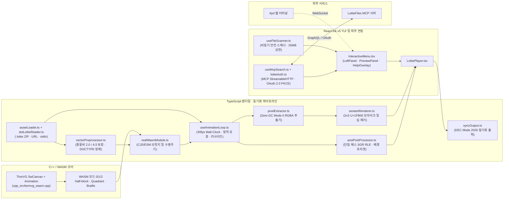

<div align="center">

# 🚀 TermVG — Terminal Vector Graphics Player

**High-Performance Terminal Lottie & SVG Player Powered by [ThorVG](https://www.thorvg.org/) (WebAssembly)**

[](https://www.npmjs.com/package/termvg)
[](https://www.thorvg.org/)
[](https://nodejs.org/)
[](https://www.typescriptlang.org/)
[](./LICENSE)
[](https://ossca-thorvg.github.io/Hackathon-Terminal_Vector_Graphics/)

[English](#english) · [한국어](#한국어)

</div>

---

## English

### 1. Overview & Web Demo Notice

**TermVG** is a high-performance CLI & Interactive TUI player that renders **Lottie animations (`.json`, `.lottie`)** and **SVG graphics (`.svg`)** directly inside your terminal at up to **30 FPS** using **[ThorVG](https://www.thorvg.org/) compiled to WebAssembly**.

Whether you are inspecting design assets over SSH, developing inside Docker containers, or working in headless terminal environments without a browser or GUI window, TermVG brings crisp sub-pixel 24-bit TrueColor vector graphics straight to your shell.

> ⚠️ **Web Demo Notice**
> The browser demo hosted on [GitHub Pages](https://ossca-thorvg.github.io/Hackathon-Terminal_Vector_Graphics/) is a limited preview intended to showcase TermVG's terminal rendering performance. Local directory scanning, terminal-optimized keyboard shortcuts, and LottieFiles MCP online search + OAuth authentication do not run in the browser sandbox.
> **To experience the full feature set, please install and run `termvg` directly in your terminal.**

---

### 2. Key Features

- **ThorVG C++ → WebAssembly Engine & Static Asset 0% CPU Idle**
  - Rasterizes Lottie JSON and SVG files via ThorVG (`SwCanvas`) compiled with Emscripten (`embind`), delivering native-grade vector rendering inside Node.js `18+`.
  - **Wall-Clock Frame Pacing (`30 FPS`)**: Synchronizes playback using `performance.now()` elapsed-time deltas so heavy frames never drift into slow motion, while clamping abnormal sleep/tab-switch spikes (`> 0.5s`) safely.
  - **Zero-CPU Static Idle**: Static SVGs and single-frame assets (`totalFrames <= 1` or `duration <= 0`) render once, display a `🖼 STATIC` (`1/1 STATIC`) indicator, and stop all animation/FPS timers (`0%` idle CPU) while still reacting immediately to terminal resizes, mode switches, dark inversion, and background preset changes.
  - **Frame-Preserving Debounced Soft Resize**: Debounces `SIGWINCH` terminal resize events (`80ms`), enforces even minimum pixel dimensions (`clampEvenPixelSize`, `>= 16×8`), and preserves the active playback frame across resizes or render-mode changes.

- **4 Sub-Cell Unicode Rendering Modes & Aspect Ratio Compensation**
  Terminal cells are physically tall (`~1:2` width-to-height ratio). TermVG overcomes low character-grid resolution with four live-switchable (`M` key) Unicode sub-pixel modes and in-memory anisotropic aspect correction:

  | Mode | Glyphs | Pixels / Cell | Effective Resolution (`80×40` Terminal) | Aspect Factor (`pixelAspectX`) | Characteristics |
  | :--- | :--- | :---: | :---: | :---: | :--- |
  | **Quadrant** *(Default TUI)* | `▖ ▗ ▘ ▝ ▞ ▟ ...` | `2 × 2 px` | `160 × 80` (`2×`) | `2.0` | Balanced sharpness and 2-color TrueColor per cell; pre-scales vector geometry (`2.0×`) in memory so `1:2` cells keep exact proportions |
  | **Sextant** | `🬀`–`🬻` (`U+1FB00..1FB3B`) | `2 × 3 px` | `160 × 120` (`3×`) | `4/3` | High-density 64-pattern Unicode 13.0 TrueColor 2-cluster mosaic via Zero-GC `WasmPixelExtractor`, solid-color seam removal (`colorDist < 15`), and `4/3` aspect correction |
  | **Braille** *(Default `termvg play`)* | `⠁ ⠂ ⠄ ⡀ ...` (`U+2800..28FF`) | `2 × 4 px` | `160 × 160` (`4×`) | `1.0` | Maximum sub-pixel geometry detail (8 dots per cell, 1 averaged TrueColor foreground per cell) |
  | **Half-block** | `▄` (`U+2584`) | `1 × 2 px` | `80 × 80` (`1×`) | `1.0` | Lossless per-pixel 24-bit TrueColor fidelity (independent top background RGB and bottom foreground RGB) |

- **Flicker-Free Double Buffering & High-Speed Single-Pass SGR RLE**
  - **DEC Private Mode `2026` Synchronized Output**: Wraps every Ink render cycle in `\x1b[?2026h` ... `\x1b[?2026l` (`createSyncStdout`) and replaces destructive clear-line/clear-screen escapes (`\x1b[2K`, `\x1b[0-2J`) with clean overwrite rendering to eliminate flickering.
  - **Zero-Regex Single-Pass SGR RLE (`ansiPostProcessor.ts`)**: Scans ANSI streams with `charCodeAt` scalar logic (zero regex or per-cell heap allocations) to omit redundant 24-bit SGR sequences, reducing per-frame ANSI byte size by **50%+** (typically 60–90% on real assets) within a **< 2 ms** budget at `160×80` cells and resetting SGR at line endings (`\x1b[0m`) to prevent color bleed.

- **4 Real-Time Background Presets & Dark-Mode Adaptation**
  - Press **`B`** at any time (even while paused or viewing static SVGs) to cycle backgrounds:
    - **`transparent`** *(Default)*: Preserves your terminal's native background (`\x1b[49m`) and eliminates black-box borders via a 16-pair `BLOCK_COMPLEMENT_LUT` glyph inversion (`▄`↔`▀`, `▘`↔`▟`, etc.).
    - **`dark`**: `#181825` (`rgb(24, 24, 37)`)
    - **`light`**: `#F5F5F7` (`rgb(245, 245, 247)`)
    - **`checkerboard`**: Alternating `#2A2A37` and `#1E1E28` transparency grid
  - Bidirectional chroma-key substitution (`inBg` and `inFg`) eliminates dark halos along anti-aliased edges on opaque presets.
  - Press **`D`** to toggle dark-mode color inversion (`invertDark`), brightening very dark shapes (`r, g, b < 40` → `200, 200, 200`) for dark terminals.

- **`.lottie` (dotLottie v1/v2), Remote URL & `stdin` Pipe Support**
  - **Zero-Dependency In-Memory `.lottie` Extractor (`dotLottieReader.ts`)**: Parses dotLottie v1 (`animations/*.json`) and v2 (`a/*.json`) ZIP containers directly in memory via Node's built-in `zlib.inflateRawSync`, inlines embedded `images/` / `i/` assets as Base64 Data URIs, and enforces Zip-Bomb (`50 MB` uncompressed / `200` entries / `maxOutputLength`) and Zip-Slip path traversal guards.
  - **Remote `http(s)://` URL & `stdin` (`-`) Streams (`assetLoader.ts`)**: Loads assets from `http://`/`https://` URLs (scheme & redirect validation, `10s` timeout, `25 MB` streaming cap) or piped `stdin` (`cat icon.svg | termvg play -`) in a dedicated non-interactive runner without Ink raw-mode conflicts.

- **Async Safe File Explorer & Conflict-Free TUI Overlays**
  - Automatically scans `process.cwd()` on startup (depth `1`), yielding every 25 filesystem entries via `setImmediate` with `AbortController` cancellation so 30 FPS playback stays responsive.
  - **Built-in Safety Guards**: Skips noisy build/dependency folders (`node_modules`, `.git`, `dist`, `build`, `.next`, `.turbo`, `coverage`, `.cache`), excludes project/lock JSON files (`package.json`, `package-lock.json`, `tsconfig*.json`, etc.), validates `.lottie` ZIP magic headers (`PK\x03\x04`) and Lottie structure (`layers` + `v`/`fr`), prevents symlink recursion loops via `realpath` tracking, and caps scanned `.svg`/`.json` files at **`25 MB`** (`.lottie` up to **`50 MB`**) to prevent V8 OOM.
  - Supports instant local filtering (`/` or `F`), cyclic recursion depth (`R`: `0 → 1 → 2 → 3 → 0`), safe directory switching (`O`, preserving the existing list on invalid/inaccessible paths), a full shortcut help modal (`?`), and a 3-tier input isolation guard so typing never triggers global hotkeys.

- **LottieFiles MCP Online Search & OAuth 2.0 PKCE QR Auth**
  - Press **`L`** to query `https://mcp.lottiefiles.com/mcp` via `@modelcontextprotocol/sdk` (`StreamableHTTPClientTransport`) + GraphQL, preview author/likes (`♥`)/downloads (`↓`), download `.json` or binary `.lottie` assets safely without UTF-8 corruption, and play immediately.
  - Uses **OAuth 2.0 Authorization Code + PKCE (`S256`)** with terminal QR codes (`qrcode-terminal`), automatic local HTTP callback server (`localhost:9876/callback` with OS dynamic port fallback), manual redirect URL/code pasting for SSH/mobile logins, and `0o600` token persistence at `~/.termvg/token.json`.

- **`2×2` Multi-Asset Grid Gallery (`G`) & Local MCP Server (`termvg mcp`)**
  - Press **`G`** in the TUI (requires terminal size `>= 60×20`) to compare up to 4 playable assets side by side in a `2×2` grid (`GridPreviewPanel.tsx`) serialized through `AsyncMutex` (`wasmMutex.ts`), isolating broken assets (`Invalid Asset`) and animating only the focused cell.
  - Run `termvg mcp` to start a Stdio JSON-RPC MCP server (`termvgMcpServer.ts`) exposing `inspect_vector` and `render_vector_snapshot` (Base64 PNG + ANSI summary) to AI coding agents while redirecting all logs to `stderr`.

- **Web Terminal Streaming (`termvg web`) & Graceful Shutdown**
  - Stream the interactive TUI to a browser via `ttyd` (`termvg web`) and safely clean up C++ WASM heap memory (`engine.delete()`) on `Q`, `SIGINT`, `SIGTERM`, and `SIGHUP`.

---

### 3. Installation

#### Option 1: npm / npx (Recommended)

Requires **Node.js `>= 18.0.0`**.

```bash
# Install globally
npm install -g termvg
termvg

# Or run directly without global installation
npx termvg
```

#### Option 2: Docker

Run TermVG without installing Node.js locally by mounting your current directory into `/data`:

```bash
docker run -it --rm -v "$(pwd):/data" -w /data node:20-slim bash -c "npm install -g termvg && termvg"
```

#### Option 3: Build from Source

```bash
git clone https://github.com/OSSCA-thorvg/Hackathon-Terminal_Vector_Graphics.git
cd Hackathon-Terminal_Vector_Graphics
npm install
npm run build

# Launch Interactive TUI in current directory (or pass ./assets)
node dist/index.js ./assets
```

---

### 4. CLI Usage & Examples

```text
Usage
  $ termvg [dir|file]
  $ termvg play <file|url|-> [options]
  $ termvg inspect <file|url|-> [--json] [--anim <id>]
  $ termvg export <file|url|-> -o <out.(png|gif|ans|txt)> [options]
  $ termvg mcp
  $ termvg web

Options
  --help     Show help
  --version  Show version
```

| Command | Behavior | Example |
| :--- | :--- | :--- |
| `termvg` | Launches the Interactive TUI and scans the current working directory (`process.cwd()`, depth `1`) | `termvg` |
| `termvg <dir>` | Launches the Interactive TUI scanning the target directory | `termvg ./assets` |
| `termvg <file>` | Opens the file's parent directory in the Interactive TUI and auto-selects `<file>` (`.svg`, `.json`, `.lottie`) | `termvg ./assets/43391.json` |
| `termvg play <file\|url\|->` | Plays a local `.svg`/`.json`/`.lottie`, remote `http(s)://` URL, or piped `stdin` (`-`) with full flags (`--mode`, `--loop`/`--no-loop`, `--speed`, `--bg`, `--invert`, `--width`, `--height`, `--anim`) | `termvg play ./assets/5317-fireworkds.json --mode quadrant --speed 1.5 --bg dark --loop` |
| `termvg inspect <file\|url\|->` | Inspects asset format, dimensions, frames, FPS, duration, layer breakdown, markers, warnings, and ThorVG WASM validity (`--json` outputs pure CI-ready JSON to `stdout`, exit `1` on invalid asset) | `termvg inspect ./assets/5317-fireworkds.json --json` |
| `termvg export <file\|url\|-> -o <out>` | Headlessly exports a `.png` snapshot (`--frame`), animated `.gif` (pure-TS GIF89a + LZW, `--size`, `--fps`), or RLE-optimized `.ans`/`.txt` ANSI art (`--mode`, `--bg`, `--invert`) | `termvg export ./assets/5317-fireworkds.json -o preview.gif --size 240x240 --fps 20` |
| `termvg mcp` | Starts a local Stdio MCP server exposing `inspect_vector` and `render_vector_snapshot` (`image/png` Base64 + ANSI preview) for AI coding agents | `termvg mcp` |
| `cat icon.svg \| termvg play -` | Reads vector/dotLottie data from `stdin` and renders in non-interactive stream mode | `cat ./assets/2961.svg \| termvg play -` |
| `termvg web` | Spawns `ttyd` (`-W -p 8080`) and opens `http://localhost:8080` in your browser *(requires `ttyd`)* | `termvg web` |
| `termvg --help` | Displays CLI usage, options, and examples | `termvg --help` |
| `termvg --version` | Prints the current TermVG version (`1.0.2`) | `termvg --version` |

> **CLI Exit Codes:** `0` = success, `1` = asset/WASM/network/I/O failure, `2` = invalid CLI flag or unsupported `export` output extension.
> **Tip:** Passing a non-existent or unreadable path to `termvg <path>` launches the TUI safely with an inline error notice rather than crashing.

---

### 5. Interactive TUI Layout & Keyboard Shortcuts

#### Split-Pane TUI Layout

```text
┌─ 30% Left Panel ─────────────┐┌──── 68% Right Panel ────────────────────────────┐
│ Name: 43391.json             ││ Live Preview ▶           42/120 30fps Space:⏯   │
│ 4.0s | 98.8kb                ││                                                 │
│ quadrant(M) Dark:OFF(D)      ││                                                 │
│ Bg:transparent(B) Depth:1(R) ││                                                 │
│ 📄 1528966158.svg            ││         (Real-Time Sub-Pixel Rendering)         │
│ > 📄 43391.json              ││         Static SVGs show: 1/1 STATIC            │
│ 📄 5317-fireworkds.json      ││         Paused state shows: ⏸ PAUSED ←→:Seek    │
│                              ││                                                 │
│ Page 1/1 (6)                 ││                                                 │
│ ↑↓ browse ←→ pages           ││                                                 │
│ /:Search R:Depth B:Bg ?:Help ││                                                 │
│ L:LottieFiles O:Open Q:Quit  ││                                                 │
└──────────────────────────────┘└─────────────────────────────────────────────────┘
```

#### Complete Keyboard Shortcuts

| Key | Action | Notes |
| :---: | :--- | :--- |
| `↑` / `↓` | Browse file or search result list | Immediately previews the highlighted Lottie/SVG asset |
| `←` / `→` | **While playing:** Previous / Next page<br>**While paused:** Frame seek backward / forward | Seek steps smoothly across animation frames (`max(1, totalFrames / 30)`) |
| `Enter` | Select item / submit input | Selects highlighted file or downloads highlighted MCP search result |
| `Space` | Toggle Play / Pause | Switches `▶` ↔ `⏸ PAUSED` (static SVGs remain `🖼 STATIC`) |
| `M` | Cycle rendering mode | `quadrant` → `sextant` → `braille` → `half-block` → `quadrant` |
| `B` | Cycle background preset | `transparent` → `dark` → `light` → `checkerboard` |
| `D` | Toggle dark-mode color inversion | `OFF` ↔ `ON` (brightens near-black strokes/fills for dark terminals) |
| `/` or `F` | Filter files in current folder | Real-time filename search; `Enter` returns focus to list, `Esc` clears |
| `R` | Cycle subdirectory scan depth | `Depth: 0 → 1 → 2 → 3 → 0` |
| `O` | Open directory by path | Keeps existing list intact if the entered path is invalid or inaccessible |
| `L` | LottieFiles MCP online search | Search public LottieFiles animations and download directly |
| `G` | Toggle `2×2` Grid Gallery view | Compare up to 4 assets (`>= 60×20` terminal); use `←→↑↓` to focus and `Enter` to open detail view |
| `?` | Toggle Help modal (`HelpOverlay`) | Displays active settings and full shortcut reference |
| `Esc` | Cancel active modal or input | Exits Path / Local Search / MCP Search / OAuth QR screen or closes Help |
| `Q` / `Ctrl+C` | Quit safely | Invokes `realWasmModule.destroy()` (`engine.delete()`) before exit |

---

### 6. LottieFiles MCP & OAuth 2.0 QR Auth Guide

1. **Open Search (`L`)**: In the Interactive TUI, press **`L`**, type a keyword (e.g., `fireworks`, `loader`, `icon`), and press `Enter`.
2. **Authenticate Once via OAuth 2.0 PKCE**:
   - If no valid cached token exists, TermVG registers a dynamic OAuth client and generates a PKCE (`S256`) challenge along with a terminal **QR code** and **Auth URL**.
   - **Desktop Browser Flow**: Open the displayed URL in your browser and approve access; TermVG's local callback server (`http://localhost:9876/callback`, or an automatically chosen OS port if `9876` is in use) captures the code automatically.
   - **Mobile QR / Remote SSH Flow**: Scan the QR code on your phone (or open the URL on another machine), then copy the redirected URL or `code` parameter and paste it directly into TermVG's input box in the terminal.
   - Press `Esc` at any time to cancel authentication cleanly.
3. **Token Caching & Auto-Refresh**: Tokens are persisted at `~/.termvg/token.json` (`0o700` directory, `0o600` file permissions) and automatically refreshed via `refresh_token` before expiry.
4. **Browse, Download & Play**: Use `↑` / `↓` to inspect animation name, `@author`, `♥` likes, and `↓` downloads in the left panel. Press `Enter` to save `<name>_by_<author>_<id>.json` into your active scanned directory (or `~/.termvg/downloads/` when no base path is active) and start playback immediately.

#### Local MCP Server Integration (`termvg mcp`)

Connect AI coding agents (Claude Desktop, Cursor, Antigravity, etc.) to TermVG's headless inspector and snapshot renderer via Stdio:

```json
{
  "mcpServers": {
    "termvg": {
      "command": "npx",
      "args": ["termvg", "mcp"]
    }
  }
}
```

---

### 7. Architecture & Rendering Pipeline


**End-to-End Frame Flow:**
1. **`vectorPreprocessor.ts`** sanitizes SVG `<!DOCTYPE>` declarations and scales SVG/Lottie coordinates in memory (`pixelAspectX = 2.0` for `quadrant`, `4/3` for `sextant`) before loading into WASM.
2. **`cpp_src/termvg_wasm.cpp`** (`src/termvg.wasm`) rasterizes the target frame via `tvg::SwCanvas` and emits Mode 0 (`Half-block`), Mode 1 (`Quadrant`), or Mode 2 (`Braille`) TrueColor ANSI.
3. For **`sextant`**, `WasmPixelExtractor` decodes lossless Mode 0 ANSI into a reusable `Uint8Array` RGBA framebuffer (`Zero-GC`), and `renderPixelsToSextant` builds 2-cluster 2×3 Unicode 13.0 mosaics with seam suppression and RLE.
4. For **`quadrant`**, **`braille`**, and **`half-block`**, `postProcessAnsiFrame` applies single-pass SGR RLE compression and background presets (`transparent` with 16-pair block complement inversion, `dark`, `light`, or `checkerboard`).
5. **`createSyncStdout`** wraps Ink's output in DEC Mode `2026` (`\x1b[?2026h` ... `\x1b[?2026l`) for tear-free, flicker-free terminal updates.

---

### 8. Recommended Terminals & Fonts

- **Recommended Terminals** *(24-bit TrueColor + Synchronized Output `\x1b[?2026h/l` support)*:
  - **macOS**: [iTerm2](https://iterm2.com/), [Ghostty](https://ghostty.org/), [Kitty](https://sw.kovidgoyal.net/kitty/), [WezTerm](https://wezfurlong.org/wezterm/)
  - **Linux**: [Ghostty](https://ghostty.org/), [Kitty](https://sw.kovidgoyal.net/kitty/), [WezTerm](https://wezfurlong.org/wezterm/), [foot](https://codeberg.org/dnkl/foot)
  - **Windows**: [Windows Terminal](https://github.com/microsoft/terminal), [WezTerm](https://wezfurlong.org/wezterm/)
- **Recommended Fonts for Sextant (`2×3`) Mode**:
  - `sextant` mode relies on **Unicode 13.0 Symbols for Legacy Computing (`U+1FB00..U+1FB3B`)**.
  - Terminals such as **Kitty**, **Ghostty**, **WezTerm**, and **foot** draw sextant box glyphs natively; on other terminals, configure a font with Unicode 13.0 Legacy Computing coverage such as **Cascadia Code**, **Noto Sans Symbols 2**, or **Symbols Nerd Font**.
  - If your terminal/font shows missing-glyph boxes in `sextant` mode, press **`M`** to switch to `quadrant`, `braille`, or `half-block`.

---

### 9. Development, Testing & License

```bash
# Run directly in TypeScript during development
npm start

# Compile TypeScript & copy WASM artifacts to dist/
npm run build

# Run full Vitest test suite (WASM integrity, RLE, aspect ratio, playback loop, scanner, sextant, README)
npm test

# Watch mode for tests
npm run test:watch
```

- 📖 **Detailed Technical Manual**: See [`./docs/DETAILS.md`](./docs/DETAILS.md) for deep-dive benchmarks, troubleshooting notes, and implementation details.
- 📄 **License**: Released under the [MIT License](./LICENSE) as part of the [ThorVG](https://www.thorvg.org/) OSSCA Hackathon.

---

<br />

## 한국어

[▲ English](#english)

### 1. 소개 및 웹 데모 안내

**TermVG**는 **[ThorVG](https://www.thorvg.org/) C++ 엔진을 WebAssembly(WASM)로 컴파일**하여, 터미널 환경에서 **Lottie 애니메이션(`.json`, `.lottie`)** 과 **SVG 벡터 그래픽(`.svg`)** 을 최대 **30 FPS** 로 실시간 렌더링하는 고성능 CLI / 대화형 TUI 플레이어입니다.

SSH 원격 서버, Docker 컨테이너, GUI 브라우저가 없는 헤드리스 개발 환경에서도 24-bit TrueColor 서브픽셀 벡터 그래픽을 셸 안에서 즉시 탐색·재생·검색할 수 있습니다.

> ⚠️ **웹 데모 페이지 이용 안내**
> [GitHub Pages 웹 데모](https://ossca-thorvg.github.io/Hackathon-Terminal_Vector_Graphics/)는 `ttyd`를 통해 TermVG의 렌더링 성능을 가볍게 체험해 보기 위한 제한된 미리보기 환경입니다. 로컬 디렉터리 탐색, 터미널 전용 단축키, LottieFiles 온라인 검색(MCP) 및 OAuth 인증 등의 핵심 기능은 브라우저 샌드박스에서 동작하지 않습니다.
> **모든 기능을 완전하게 사용하려면 아래 설치 방법에 따라 터미널(CLI)에서 직접 설치하여 실행해 주세요.**

---

### 2. 핵심 특징

- **ThorVG C++ → WebAssembly 엔진 및 정적 SVG 0% CPU 유휴화**
  - Emscripten(`embind`)으로 컴파일된 ThorVG(`SwCanvas`)가 Node.js `18+` 환경에서 Lottie JSON 및 SVG 벡터를 네이티브급 속도로 래스터라이징합니다.
  - **Wall-Clock 프레임 동기화 (`30 FPS`)**: `performance.now()` 실측 경과 시간 기반으로 프레임을 진행하여 렌더링 부하 시 슬로우 모션 현상을 방지하며, 절전·탭 전환으로 인한 비정상 시간 스파이크(`> 0.5s`)는 안전하게 클램핑(`0.1s`)합니다.
  - **정적 에셋 0% CPU 유휴 처리**: 단일 프레임 SVG 등 정적 에셋(`totalFrames <= 1` 또는 `duration <= 0`)은 1회 렌더링 후 `🖼 STATIC` (`1/1 STATIC`) 배지를 표시하고 모든 타이머를 정지하여 **CPU 점유율 0%** 상태를 유지합니다. (터미널 리사이즈, 모드 전환, `D`/`B` 토글 시에는 즉시 재렌더링)
  - **프레임 보존 디바운스 리사이즈**: 터미널 창 크기 변경 시 `80ms` 디바운스 및 최소 짝수 해상도 정규화(`clampEvenPixelSize`, `>= 16×8`)를 적용하며, 리사이즈나 모드 전환 중에도 현재 재생 프레임 위치를 유지합니다.

- **4가지 서브픽셀 유니코드 렌더링 모드 & 인메모리 종횡비 자동 보정**
  터미널 문자 셀은 가로:세로 비율이 약 `1:2`인 세로형 격자입니다. TermVG는 `M` 키로 실시간 전환 가능한 4가지 유니코드 모드와 인메모리 비등방 종횡비 보정(`vectorPreprocessor.ts`)으로 왜곡 없는 선명한 출력을 제공합니다.

  | 모드 | 사용 문자 | 셀당 해상도 | 유효 픽셀 (`80×40` 터미널 기준) | 종횡비 보정 (`pixelAspectX`) | 특징 |
  | :--- | :--- | :---: | :---: | :---: | :--- |
  | **Quadrant** *(TUI 기본값)* | `▖ ▗ ▘ ▝ ▞ ▟ ...` | `2 × 2 px` | `160 × 80` (`2×`) | `2.0` | 해상도와 색감의 균형; `1:2` 물리 셀의 세로 2배 왜곡을 인메모리 `2.0×` 스케일링으로 완벽 보정 |
  | **Sextant** | `🬀`–`🬻` (`U+1FB00..1FB3B`) | `2 × 3 px` | `160 × 120` (`3×`) | `4/3` | Zero-GC `WasmPixelExtractor` 기반 Unicode 13.0 64패턴 2-클러스터 Luma 모자이크, 단색 심(Seam) 제거(`colorDist < 15`), `4/3` 정방형 보정 |
  | **Braille** *(`termvg play` 기본값)* | `⠁ ⠂ ⠄ ⡀ ...` (`U+2800..28FF`) | `2 × 4 px` | `160 × 160` (`4×`) | `1.0` | 8-dot 점자 기반 최고 서브픽셀 해상도 (셀당 평균 1개 TrueColor 전경색) |
  | **Half-block** | `▄` (`U+2584`) | `1 × 2 px` | `80 × 80` (`1×`) | `1.0` | 픽셀 단위 손실 없는 24-bit TrueColor 표현 (상단 배경 RGB + 하단 전경 RGB 독립 제어) |

- **깜빡임 없는 더블 버퍼링 & 단일 패스 SGR RLE 압축**
  - **DEC Private Mode `2026` Synchronized Output**: `createSyncStdout`가 매 Ink 렌더 사이클 앞뒤를 `\x1b[?2026h` ~ `\x1b[?2026l` 로 감싸고 화면 지우기 시퀀스(`\x1b[2K`, `\x1b[0-2J`)를 제거해 덮어쓰기(Overwrite) 방식으로 깜빡임 없는 출력을 보장합니다.
  - **단일 패스 SGR RLE 후처리기 (`ansiPostProcessor.ts`)**: 정규식이나 힙 할당 없는 `charCodeAt` 상태 머신으로 인접 셀의 중복 SGR 이스케이프를 제거하여 프레임당 ANSI 바이트 크기를 **50% 이상**(실제 에셋 기준 60~90%) 절감하고 `160×80` 기준 **< 2ms** 내에 처리합니다.

- **4종 실시간 배경 프리셋 & 다크 모드 색상 적응**
  - 일시정지나 정적 SVG 상태에서도 **`B`** 키를 눌러 배경 프리셋을 즉시 순환할 수 있습니다.
    - **`transparent`** *(기본값)*: 터미널 고유 배경(`\x1b[49m`)을 유지하며, 16-쌍 `BLOCK_COMPLEMENT_LUT` 보수 글리프 반전(`▄`↔`▀`, `▘`↔`▟` 등)으로 검은 테두리 박스 없이 투명을 구현합니다.
    - **`dark`**: 딥 슬레이트 `#181825` (`rgb(24, 24, 37)`)
    - **`light`**: 밝은 라이트 `#F5F5F7` (`rgb(245, 245, 247)`)
    - **`checkerboard`**: `#2A2A37` / `#1E1E28` 교차 투명도 체크 격자
  - 불투명 프리셋 경계 셀의 `inBg`/`inFg` 양방향 크로마키 치환으로 Black Halo 현상을 제거하며, **`D`** 키로 다크 모드 색상 반전(`invertDark`, 어두운 `< 40` 픽셀을 `200, 200, 200`으로 보정)을 토글할 수 있습니다.

- **`.lottie` (dotLottie v1/v2), 원격 URL 및 `stdin` 파이프 입력 지원**
  - **무의존성 인메모리 `.lottie` 추출기 (`dotLottieReader.ts`)**: Node.js 내장 `zlib.inflateRawSync`와 ZIP EOCD 파서로 dotLottie v1(`animations/*.json`)·v2(`a/*.json`) 컨테이너를 메모리에서 직접 해제하고 `images/`/`i/` 이미지를 Base64 Data URI로 인라인 치환합니다. `50 MB` 누적 해제 상한, `200개` 엔트리 제한, `maxOutputLength` 가드 및 Zip-Slip(`..`) 차단으로 악성 아카이브를 방어합니다.
  - **원격 `http(s)://` URL 및 `stdin` (`-`) 스트림 로더 (`assetLoader.ts`)**: `http://`/`https://` URL(스킴·리다이렉트 재검증, `10초` 타임아웃, `25 MB` 스트리밍 상한)과 파이프 표준 입력(`cat icon.svg | termvg play -`)을 Ink raw-mode 충돌 없는 비대화형 실행기로 안전하게 재생합니다.

- **비동기 안전 파일 탐색기 & 충돌 방지 TUI 오버레이**
  - 실행 즉시 현재 작업 디렉터리(`process.cwd()`, 기본 깊이 `1`)를 비동기 스캔하며, 25개 엔트리마다 `setImmediate` 양보 및 `AbortController` 취소로 30 FPS 재생 끊김을 차단합니다.
  - **안전 방어 장치**: `node_modules`·`.git`·`dist`·`build` 등 빌드 폴더 제외, 설정/락 JSON(`package.json`, `package-lock.json`, `tsconfig*.json` 등) 자동 필터링, `.lottie` ZIP 매직 헤더(`PK\x03\x04`) 및 Lottie 구조(`layers` + `v`/`fr`) 검증, `realpath` 기반 심볼릭 링크 무한 루프 차단, **`.svg`/`.json` `25 MB`**(및 `.lottie` `50 MB`) 초과 파일 스킵(V8 OOM 방지).
  - 로컬 파일명 실시간 필터(`/` 또는 `F`), 재귀 깊이 순환(`R`: `0 → 1 → 2 → 3 → 0`), 경로 직접 입력(`O`, 잘못된 경로 입력 시 기존 목록 유지), 전체 단축키 도움말 오버레이(`?`), 텍스트 입력 중 전역 단축키 발동 차단(3단계 입력 격리 가드)을 제공합니다.

- **LottieFiles MCP 온라인 검색 & OAuth 2.0 PKCE QR 인증**
  - **`L`** 키로 `https://mcp.lottiefiles.com/mcp` 서버에 `@modelcontextprotocol/sdk` (`StreamableHTTPClientTransport`) + GraphQL로 연결해 공개 애니메이션을 검색하고 작성자·좋아요(`♥`)·다운로드(`↓`) 메타데이터 확인 및 `.json`/바이너리 `.lottie` 에셋 무손실 다운로드·즉시 재생이 가능합니다.
  - 터미널 **QR 코드**(`qrcode-terminal`), 동적 포트 폴백을 지원하는 로컬 HTTP 콜백 서버(`localhost:9876/callback`), SSH/모바일 로그인을 위한 리다이렉트 URL/코드 수동 붙여넣기, `~/.termvg/token.json` (`0o600` 소유자 전용 권한) 자동 토큰 갱신을 지원합니다.

- **`2×2` 멀티 에셋 그리드 갤러리(`G`) & 로컬 MCP 서버(`termvg mcp`)**
  - TUI에서 **`G`** 키(`60×20` 이상 창)를 누르면 현재 페이지 최대 4개 에셋을 `AsyncMutex`(`wasmMutex.ts`) 직렬 스냅샷으로 안전하게 비교하고(`GridPreviewPanel.tsx`), 포커스 타일만 실시간 재생하며 손상 파일은 `Invalid Asset`으로 격리합니다.
  - `termvg mcp` 실행 시 AI 코딩 에이전트 연동용 Stdio JSON-RPC MCP 서버(`termvgMcpServer.ts`)로 기동되어 `inspect_vector`와 `render_vector_snapshot`(PNG Base64 + ANSI 프리뷰)을 제공하며 모든 로그는 `stderr`로 격리됩니다.

- **웹 터미널 스트리밍(`termvg web`) & 안전한 종료(Graceful Shutdown)**
  - `ttyd` 기반 `termvg web` 브라우저 스트리밍 및 `Q` / `SIGINT` / `SIGTERM` / `SIGHUP` 시그널 수신 시 WASM C++ 소멸자(`engine.delete()`)를 안전하게 호출합니다.

---

### 3. 설치 방법

#### 방법 1: npm / npx (권장)

**Node.js `>= 18.0.0`** 환경이 필요합니다.

```bash
# 전역 설치 후 실행
npm install -g termvg
termvg

# 전역 설치 없이 바로 실행
npx termvg
```

#### 방법 2: Docker

로컬에 Node.js를 설치하지 않고 현재 폴더를 `/data`로 마운트하여 즉시 실행할 수 있습니다.

```bash
docker run -it --rm -v "$(pwd):/data" -w /data node:20-slim bash -c "npm install -g termvg && termvg"
```

#### 방법 3: 로컬 소스 코드 빌드

```bash
git clone https://github.com/OSSCA-thorvg/Hackathon-Terminal_Vector_Graphics.git
cd Hackathon-Terminal_Vector_Graphics
npm install
npm run build

# 샘플 에셋 폴더로 대화형 TUI 실행
node dist/index.js ./assets
```

---

### 4. CLI 사용 방법 및 예시

```text
Usage
  $ termvg [dir|file]
  $ termvg play <file|url|-> [options]
  $ termvg inspect <file|url|-> [--json] [--anim <id>]
  $ termvg export <file|url|-> -o <out.(png|gif|ans|txt)> [options]
  $ termvg mcp
  $ termvg web

Options
  --help     Show help
  --version  Show version
```

| 명령어 | 동작 설명 | 실행 예시 |
| :--- | :--- | :--- |
| `termvg` | 현재 작업 디렉터리(`process.cwd()`, 깊이 `1`)를 자동 스캔하여 대화형 TUI 실행 | `termvg` |
| `termvg <dir>` | 지정한 디렉터리를 스캔하며 대화형 TUI 실행 | `termvg ./assets` |
| `termvg <file>` | 파일이 속한 상위 디렉터리를 스캔하고 해당 파일(`.svg`, `.json`, `.lottie`)을 자동 선택·재생 | `termvg ./assets/43391.json` |
| `termvg play <file\|url\|->` | 로컬 파일, 원격 `http(s)://` URL, `stdin`(`-`)을 확장 플래그(`--mode`, `--loop`/`--no-loop`, `--speed`, `--bg`, `--invert`, `--width`, `--height`, `--anim`)로 재생 | `termvg play ./assets/5317-fireworkds.json --mode quadrant --speed 1.5 --bg dark --loop` |
| `termvg inspect <file\|url\|->` | 포맷, 해상도, 프레임 수, FPS, 재생 시간, 레이어 통계, 마커, 호환성 경고 및 ThorVG WASM 로드 유효성 진단 (`--json` 순수 JSON `stdout` 출력) | `termvg inspect ./assets/5317-fireworkds.json --json` |
| `termvg export <file\|url\|-> -o <out>` | 헤드리스 `.png` 스냅샷(`--frame`), 애니메이션 `.gif`(순수 TS GIF89a + LZW, `--size`, `--fps`), RLE 최적화 `.ans`/`.txt` ANSI 아트 추출 | `termvg export ./assets/5317-fireworkds.json -o preview.gif --size 240x240 --fps 20` |
| `termvg mcp` | AI 코딩 에이전트용 로컬 Stdio MCP 서버 기동 (`inspect_vector`, `render_vector_snapshot` `image/png` Base64 + ANSI 요약 제공) | `termvg mcp` |
| `cat icon.svg \| termvg play -` | 표준 입력(`stdin`)으로 전달된 벡터/dotLottie 데이터를 비대화형 스트림 모드로 재생 | `cat ./assets/2961.svg \| termvg play -` |
| `termvg web` | `ttyd` (`-W -p 8080`) 웹 터미널 서버를 띄우고 브라우저(`http://localhost:8080`) 열기 *(별도 `ttyd` 설치 필요)* | `termvg web` |
| `termvg --help` | CLI 도움말 및 예시 출력 | `termvg --help` |
| `termvg --version` | 현재 설치된 TermVG 버전 출력 (`1.0.2`) | `termvg --version` |

> **CLI 종료 코드:** `0` = 정상 완료, `1` = 에셋/WASM/네트워크/파일 I/O 실패, `2` = 잘못된 CLI 플래그 또는 미지원 `export` 확장자.
> **참고:** 존재하지 않거나 접근 권한이 없는 경로를 인자로 전달해도 크래시 없이 TUI 내부에 안내 메시지를 표시하며 안전하게 실행됩니다.

---

### 5. 대화형 TUI 화면 구조 및 전체 단축키

#### 2-패널 분할 TUI 레이아웃

```text
┌─ 30% Left Panel ─────────────┐┌──── 68% Right Panel ────────────────────────────┐
│ Name: 43391.json             ││ Live Preview ▶           42/120 30fps Space:⏯   │
│ 4.0s | 98.8kb                ││                                                 │
│ quadrant(M) Dark:OFF(D)      ││                                                 │
│ Bg:transparent(B) Depth:1(R) ││                                                 │
│ 📄 1528966158.svg            ││         (실시간 서브픽셀 벡터 렌더링 영역)         │
│ > 📄 43391.json              ││         정적 SVG 표시: 1/1 STATIC               │
│ 📄 5317-fireworkds.json      ││         일시정지 시: ⏸ PAUSED ←→:Seek           │
│                              ││                                                 │
│ Page 1/1 (6)                 ││                                                 │
│ ↑↓ browse ←→ pages           ││                                                 │
│ /:Search R:Depth B:Bg ?:Help ││                                                 │
│ L:LottieFiles O:Open Q:Quit  ││                                                 │
└──────────────────────────────┘└─────────────────────────────────────────────────┘
```

#### 전체 키보드 단축키 표

| 키 | 동작 | 상세 설명 |
| :---: | :--- | :--- |
| `↑` / `↓` | 파일 및 검색 목록 탐색 | 커서 하이라이트 이동 시 우측 프리뷰 즉시 전환 |
| `←` / `→` | **재생 중:** 이전/다음 페이지 이동<br>**일시정지 중:** 프레임 단위 뒤로/앞으로 시크 | 일시정지 상태에서 `max(1, totalFrames / 30)` 간격으로 정밀 프레임 탐색 |
| `Enter` | 항목 선택 / 입력 확정 | 파일 선택 또는 LottieFiles 검색 결과 다운로드·재생 |
| `Space` | 재생 / 일시정지 토글 | `▶` ↔ `⏸ PAUSED` 전환 (정적 SVG는 `🖼 STATIC` 유지) |
| `M` | 렌더링 모드 순환 | `quadrant` → `sextant` → `braille` → `half-block` → `quadrant` |
| `B` | 배경 프리셋 순환 | `transparent` → `dark` → `light` → `checkerboard` |
| `D` | 다크 모드 색상 반전 토글 | `OFF` ↔ `ON` (어두운 선/도형을 밝은 회색으로 보정) |
| `/` 또는 `F` | 현재 폴더 로컬 파일명 검색 | 실시간 필터링; `Enter`로 결과 리스트 이동, `Esc`로 필터 해제 |
| `R` | 하위 폴더 스캔 깊이 순환 | `Depth: 0 → 1 → 2 → 3 → 0` |
| `O` | 탐색할 디렉터리 경로 직접 입력 | 유효하지 않거나 권한 없는 경로 입력 시 기존 파일 목록 보존 |
| `L` | LottieFiles MCP 온라인 검색 | MCP 서버를 통한 공개 에셋 검색 모드 진입 |
| `G` | `2×2` 그리드 갤러리 뷰 토글 | 최대 4개 에셋 동시 비교 (`60×20` 이상 터미널), `←→↑↓` 포커스 이동 후 `Enter`로 상세 진입 |
| `?` | 단축키 도움말 오버레이 토글 | 현재 설정 및 전체 단축키 모달(`HelpOverlay`) 열기/닫기 |
| `Esc` | 입력 취소 / 도움말 닫기 | 경로 입력·로컬 검색·MCP 검색·QR 인증 취소 또는 도움말 모달 닫기 |
| `Q` / `Ctrl+C` | 안전한 리소스 해제 후 종료 | `realWasmModule.destroy()` (`engine.delete()`) 호출 후 정상 종료 |

---

### 6. LottieFiles MCP 연동 및 OAuth 2.0 QR 인증 가이드

1. **검색 모드 열기 (`L`)**: 대화형 TUI에서 **`L`** 키를 누르고 검색어(예: `rocket`, `loading`, `fireworks`)를 입력한 뒤 `Enter`를 누릅니다.
2. **최초 1회 OAuth 2.0 PKCE 인증**:
   - 유효한 캐시 토큰이 없으면 TermVG가 동적 클라이언트 등록과 PKCE(`S256`) 챌린지를 생성해 터미널에 **QR 코드**와 **인증 URL**을 표시하고 로컬 콜백 서버(`http://localhost:9876/callback`, 포트 충돌 시 OS 가용 포트로 자동 폴백)를 엽니다.
   - **로컬 PC 브라우저 인증**: 표시된 URL을 브라우저에서 열어 로그인·승인하면 로컬 콜백 서버가 코드를 자동 수신해 검색을 이어갑니다.
   - **모바일 QR / 원격 SSH 인증**: 스마트폰으로 QR 코드를 스캔하거나 다른 기기에서 인증한 뒤, 리다이렉트된 URL 전체 또는 `code` 값을 터미널 입력창에 직접 붙여넣고 `Enter`를 누르면 완료됩니다. (`Esc`로 언제든 취소 가능)
3. **토큰 저장 및 자동 갱신**: 인증 토큰은 소유자 전용 권한(`0o700` 디렉터리, `0o600` 파일)으로 `~/.termvg/token.json`에 저장되며 만료 전 `refresh_token`으로 자동 갱신됩니다.
4. **메타 확인 · 다운로드 · 즉시 재생**: `↑` / `↓` 로 이름, `@작성자`, `♥` 좋아요, `↓` 다운로드 수를 확인하고 `Enter`를 누르면 현재 스캔 디렉터리(기본 경로 미지정 시 `~/.termvg/downloads/`)에 `<이름>_by_<작성자>_<ID>.json` 으로 저장되어 즉시 재생됩니다.

#### 로컬 MCP 서버 연동 (`termvg mcp`)

Claude Desktop, Cursor, Antigravity 등 AI 코딩 에이전트 설정에 아래 `mcpServers` 구성을 추가해 벡터 에셋 진단 및 PNG 스냅샷 렌더링을 연동할 수 있습니다:

```json
{
  "mcpServers": {
    "termvg": {
      "command": "npx",
      "args": ["termvg", "mcp"]
    }
  }
}
```

---

### 7. 아키텍처 및 렌더링 파이프라인



**렌더링 파이프라인 요약:**
1. **`vectorPreprocessor.ts`**: SVG의 `<!DOCTYPE>` 선언을 제거하고 모드별 가상 픽셀 종횡비(`quadrant`: `2.0`, `sextant`: `4/3`)로 인메모리 좌표를 보정한 뒤 WASM에 적재합니다.
2. **`cpp_src/termvg_wasm.cpp`** (`src/termvg.wasm`): ThorVG `SwCanvas`가 프레임을 래스터라이징하여 Mode 0(`Half-block`), Mode 1(`Quadrant`), Mode 2(`Braille`) 24-bit ANSI 문자열을 반환합니다.
3. **`sextant` 모드**: `WasmPixelExtractor`가 무손실 Mode 0 ANSI를 재사용 가능한 `Uint8Array` RGBA 버퍼로 디코딩하고, `renderPixelsToSextant`가 2-클러스터 Luma 양자화·단색 심 제거·RLE 압축을 적용한 2×3 Sextant ANSI를 생성합니다.
4. **일반 모드 (`quadrant` / `braille` / `half-block`)**: `postProcessAnsiFrame`이 단일 패스 SGR RLE 압축과 배경 프리셋(`transparent` 보수 반전, `dark`, `light`, `checkerboard`) 치환을 수행합니다.
5. **`createSyncStdout`**: Ink의 모든 프레임 출력을 DEC Mode `2026` (`\x1b[?2026h` ~ `\x1b[?2026l`)으로 감싸 깜빡임 없는 화면 갱신을 완성합니다.

---

### 8. 권장 터미널 및 폰트 환경

- **권장 터미널** *(24-bit TrueColor 및 Synchronized Output `\x1b[?2026h/l` 지원)*:
  - **macOS**: [iTerm2](https://iterm2.com/), [Ghostty](https://ghostty.org/), [Kitty](https://sw.kovidgoyal.net/kitty/), [WezTerm](https://wezfurlong.org/wezterm/)
  - **Linux**: [Ghostty](https://ghostty.org/), [Kitty](https://sw.kovidgoyal.net/kitty/), [WezTerm](https://wezfurlong.org/wezterm/), [foot](https://codeberg.org/dnkl/foot)
  - **Windows**: [Windows Terminal](https://github.com/microsoft/terminal), [WezTerm](https://wezfurlong.org/wezterm/)
- **Sextant(`2×3`) 모드 폰트 안내**:
  - `sextant` 모드는 **Unicode 13.0 Symbols for Legacy Computing (`U+1FB00..U+1FB3B`)** 글리프를 사용합니다.
  - **Kitty**, **Ghostty**, **WezTerm**, **foot** 등은 해당 블록 글리프를 자체 내장 렌더링하며, 그 외 터미널에서는 **Cascadia Code**, **Noto Sans Symbols 2**, **Symbols Nerd Font** 등 Unicode 13.0 지원 폰트 사용을 권장합니다.
  - 사용 중인 터미널/폰트에서 Sextant 문자가 깨져 보일 경우 **`M`** 키를 눌러 `quadrant`, `braille`, `half-block` 모드로 즉시 전환할 수 있습니다.

---

### 9. 개발, 테스트 및 라이선스

```bash
# 개발 모드 실행 (tsx)
npm start

# TypeScript 빌드 및 dist/termvg.{cjs,wasm} 복사
npm run build

# 전체 Vitest 단위·통합 테스트 실행
npm test

# 테스트 워치 모드
npm run test:watch
```

- 📖 **상세 기술 매뉴얼**: 성능 벤치마크, 트러블슈팅 사례 및 내부 구조는 [`./docs/DETAILS.md`](./docs/DETAILS.md) 에서 확인할 수 있습니다.
- 📄 **라이선스**: 이 프로젝트는 [ThorVG](https://www.thorvg.org/) OSSCA 해커톤의 일환으로 제작되었으며 [MIT License](./LICENSE) 를 따릅니다.

---

<p align="center">
  <b>TermVG</b> — Render Vector Graphics Anywhere Your Terminal Lives.
</p>
